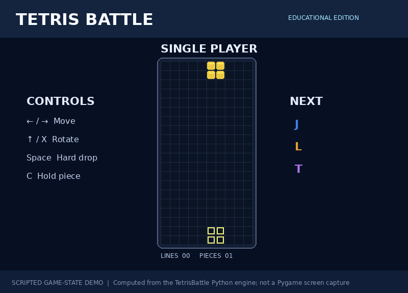
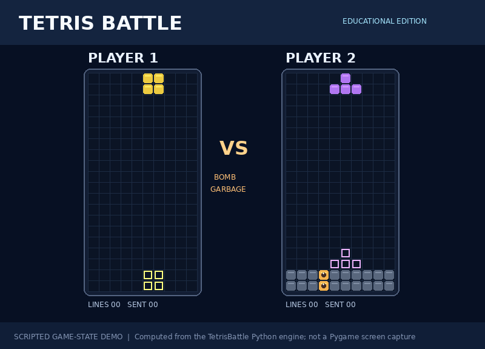

# TetrisBattle — Educational Edition

[](https://www.python.org/) [](LICENSE) [](NOTICE.md)

An **unofficial, non-commercial educational adaptation** of the Python/Pygame TetrisBattle project. Based on [ylsung/TetrisBattle](https://github.com/ylsung/TetrisBattle), with improvements to keyboard controls, versus play, top-out detection, garbage bombs, Combo sounds, and selectable visual styles. Original game artwork and sound references are credited to [greenspiritcompany/tetrisfb-assets](https://github.com/greenspiritcompany/tetrisfb-assets).

> **Important:** Educational intent does not grant permission to redistribute copyrighted third-party assets. See [NOTICE.md](NOTICE.md). The original MIT-licensed code retains its MIT license; this project does **not** change those terms.

## Gameplay GIFs

| Single-player demonstration | Two-player demonstration |
| :--: | :--: |
|  |  |

**How these GIFs were made:** These two animations were generated by this project’s actual Python `Tetris` gameplay/state logic and rendered with a custom lightweight display. **They are scripted game-state demonstrations, not recordings of a running Pygame window, and not footage of the old upstream project.** They have no sound. For a genuine live game-window GIF, use [`tools/record_live_gameplay.py`](tools/record_live_gameplay.py) on a PC with Pygame; see [Recording guide](docs/RECORD_GIF.md).

A static illustration of the optional original-style visual assets is available at [Visual Phase 1 Preview](docs/media/visual-phase1-preview.jpg). It is not a live screenshot.

## Features

- Single-player and local **two-player** versus on one keyboard.
- Immediate left/right response, adjustable **DAS/ARR**, improved rotation with SRS-style wall kicks, optional WASD controls, and a custom keymap JSON.
- Single-player **Space = Hard Drop**, including the first playable frame.
- Hold, next-piece preview, ghost piece, T-Spin detection, Combo, Back-to-Back, Perfect Clear, and garbage attack/cancellation.
- Versus garbage contains **bomb cells**, not the old B/Y 3×3 item. Contact clears garbage rows and can chain.
- **Instant top-out/KO** in two-player matches; simultaneous top-outs result in a draw.
- Audio effects, music toggle, volume control, optional extracted game sounds, and original-style visuals where the media files are available.
- Windows game-window input handling attempts to prevent IME composition from intercepting keyboard controls.
- Legacy AI/Gym interface remains in the codebase; refer to its original dependencies separately.

## Requirements and setup

Recommended: **Python 3.10–3.12**, Pygame and NumPy, a display, and optionally a sound device.

```bash
python -m pip install -r requirements.txt
```

Run commands from the **project root** (the directory containing `game/` and `TetrisBattle/`).

## Start the game

```bash
# Single-player, start the board immediately
python -m game.tetris_game --mode single --map none

# Single-player through the menu
python -m game.tetris_game --mode single

# Single-player with WASD
python -m game.tetris_game --mode single --map none --controls wasd

# Two-player versus, immediate start
python -m game.tetris_game --mode double --map none

# Diagnose keyboard events / window focus
python -m game.tetris_game --mode single --map none --debug-input
```

On Windows, run `start_single_windows.bat`, `start_menu_windows.bat` or `start_double_windows.bat` after installing the dependencies. On Linux/macOS, use the matching `start_*.sh` scripts.

## Keyboard controls

| Action | Player 1 (single/versus) | Player 2 (versus) |
| --- | --- | --- |
| Move left/right | `←` / `→` | `H` / `K` |
| Soft drop | `↓` | `J` |
| Rotate clockwise | `↑` or `X` | `U` or `I` |
| Rotate counterclockwise | `Z` | `Q` |
| **Hard drop** | **`Space`** | `W` |
| Hold | `C` / Left Shift | `E` |

Single-player WASD: `A`/`D` move, `S` soft drop, `W`/`X` rotate clockwise; **Space remains Hard Drop**.

| Shortcut | Action |
| --- | --- |
| `Enter` / `Space` | Confirm map selection |
| `Tab` | Toggle player count in main menu |
| `F1` | Display game help |
| `F2` | Toggle single-player Classic/WASD in menu |
| `P` | Pause / resume |
| `R` | Restart |
| `Esc` | Return to menu |
| `F3` | Toggle visual effects |
| `F4` | Toggle garbage bombs in menu |
| `F5` / `F6` / `F7` | Cycle block / ghost / bomb skins |
| `F8` | Toggle original-style / legacy visuals |
| `M` / `N` | Toggle music / sound effects |
| `-` / `=` | Lower / raise volume |

When confirming a map with Space, release it before attempting the first in-game Hard Drop.

## Versus bombs, Combo and visuals

Bombs are **special cells inside incoming garbage rows**. Locking a block directly above the bomb may clear the row and trigger a chain of aligned bombs. You do not activate them with `B` or `Y`. The implementation is informed by historical game descriptions, **not a claim of complete equivalence** with every Facebook version.

A Combo increases when consecutive locking pieces each clear at least one line. The extracted Flash archive includes **seven** distinct original Combo sound symbols (`FX_COMBO01`–`FX_COMBO07`); higher sound tiers reuse the last available sound. Original media is optional and subject to its own rights.

```bash
# Faster held movement
python -m game.tetris_game --mode single --map none --das-ms 90 --arr-ms 18 --soft-drop-ms 20

# Run without original-style artwork, sound, or effects
python -m game.tetris_game --mode double --map none --no-original-visuals --no-audio --no-effects

# Choose optional visual styles (falls back when assets are absent)
python -m game.tetris_game --mode double --map none --mino-skin neon --ghost-skin shadow --bomb-skin thunder
```

## Tests and known limitations

```bash
python -m pip install pytest
python -m pytest -q
```

Earlier builds reported 140 automated tests for the full-asset package. Tests do **not** replace Windows IME, physical keyboard, audio, and real Pygame GUI validation. Some media-dependent tests are skipped in the code-only public package. The generated GIFs reflect game-state logic, not a GUI test.

If your keyboard does not respond, click inside the game window and try `--debug-input`. For persistent Windows IME interception, switch to an English keyboard temporarily (`Win + Space`). If a match does not end on top-out, attach the traceback and game version to an issue.

## Project structure

```text
TetrisBattle/        Core board model, renderer, controls, audio, visual effects
TetrisBattle/assets/  Images, music, and optional original-derived media
 game/               Playable Pygame entry point
 tools/              Audio conversion, GitHub publishing, GIF tools
 tests/              Automated tests
 docs/media/         Scripted GIF demonstrations and visual preview
 docs/               Instructions, media/recording notes, release guidance
```

## Changes and acknowledgements

See [CHANGELOG.md](CHANGELOG.md) for the feature and bug-fix history and [NOTICE.md](NOTICE.md) for attribution, copyright and the non-commercial educational statement.

- **Original software:** [ylsung/TetrisBattle](https://github.com/ylsung/TetrisBattle), MIT-licensed upstream code; original authors also acknowledge [xuyuwei/tetris-battle](https://github.com/xuyuwei/tetris-battle).
- **Original-style artwork and sounds (optional):** [greenspiritcompany/tetrisfb-assets](https://github.com/greenspiritcompany/tetrisfb-assets). Availability does not imply a redistribution license.
- **Demonstration GIFs in this README:** independently scripted/rendered for this adaptation using the actual game-state logic; not footage from original Facebook Tetris Battle.

## Educational and non-commercial statement

This is an **unofficial, independent, not-for-profit educational and research project** intended for learning Python, Pygame and game systems. It is not affiliated with, sponsored by, or endorsed by Tetris, Facebook, Meta, or the original developers/publishers. All underlying rights remain with their owners. **Non-commercial use and attribution are not substitutes for permissions** to copy or distribute third-party media. See [NOTICE.md](NOTICE.md).